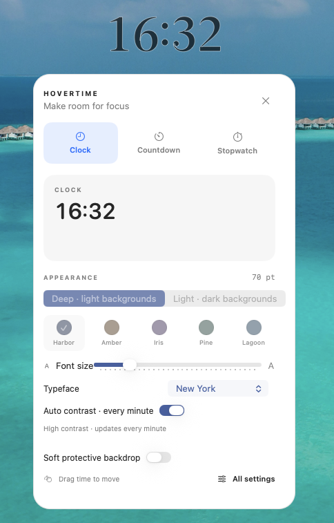

# HoverTime Desktop Timer

Floating desktop clock, countdown, and stopwatch for macOS. HoverTime stays above your work without taking over the screen, so you can keep time visible while writing, coding, presenting, streaming, or working in fullscreen apps.

[中文说明](README.zh-CN.md)

## Features

- Floating always-on-top timer window for macOS
- Clock, countdown, and stopwatch modes
- Visible across Spaces and fullscreen apps
- Manual light and deep color palettes, adjustable size and typeface
- Optional automatic black/white contrast based on the floating region, checked once per minute
- Click the floating timer to open compact controls
- Draggable position with automatic position memory
- Optional click-through mode
- Global seconds toggle shared by all timer modes
- Countdown duration picker with plus/minus controls and 5-minute steps
- Font size controls with 5-point increments
- Optional reminder pulse every N minutes
- Menu bar controls and optional Dock icon
- Native macOS notifications and sound for countdown completion

## Why HoverTime

Most timer apps either live in the menu bar where they are easy to ignore, or open a full window that competes with your work. HoverTime is designed as a small persistent overlay: visible enough to help, quiet enough to forget.

Good for:

- focus sessions and Pomodoro-style work
- presenters who need a visible countdown
- streamers and screen recordings
- keeping wall-clock time visible in fullscreen apps
- lightweight stopwatch timing

## Build

### Requirements

- macOS 15 or later
- Xcode or Apple Command Line Tools with Swift

### Xcode

1. Open `HoverTime.xcodeproj`
2. Select the `HoverTime` scheme
3. Press `Cmd+R`

### Manual App Bundle

The project can also be compiled without `xcodebuild`:

```bash
swiftc -target arm64-apple-macosx15.0 \
  -module-cache-path /private/tmp/hovertime-module-cache \
  -parse-as-library -O \
  -framework SwiftUI -framework AppKit -framework Combine -framework UserNotifications \
  HoverTime/TimerManager.swift HoverTime/FloatingPanel.swift HoverTime/ContentView.swift \
  HoverTime/SettingsView.swift HoverTime/MainView.swift HoverTime/MenuBarView.swift \
  HoverTime/AppDelegate.swift HoverTime/HoverTimeApp.swift \
  -o dist/HoverTime.app/Contents/MacOS/HoverTime
```

## Project Structure

| File | Purpose |
| --- | --- |
| `HoverTimeApp.swift` | App entry point and SwiftUI scenes |
| `AppDelegate.swift` | Floating panel setup, Dock visibility, app lifecycle |
| `FloatingPanel.swift` | Always-on-top transparent `NSPanel` |
| `TimerManager.swift` | Clock, countdown, stopwatch, reminders, persistence |
| `ContentView.swift` | Floating timer display and colon click target |
| `CompactControlPanel.swift` | Temporary quick controls panel |
| `SettingsView.swift` | Full settings window |
| `MenuBarView.swift` | Menu bar commands |

## Release

See [RELEASE.md](RELEASE.md) for the current release notes.

## Screenshot

<a href="show/hovertime-controls.png"></a>

Click the image to view it at full size.
